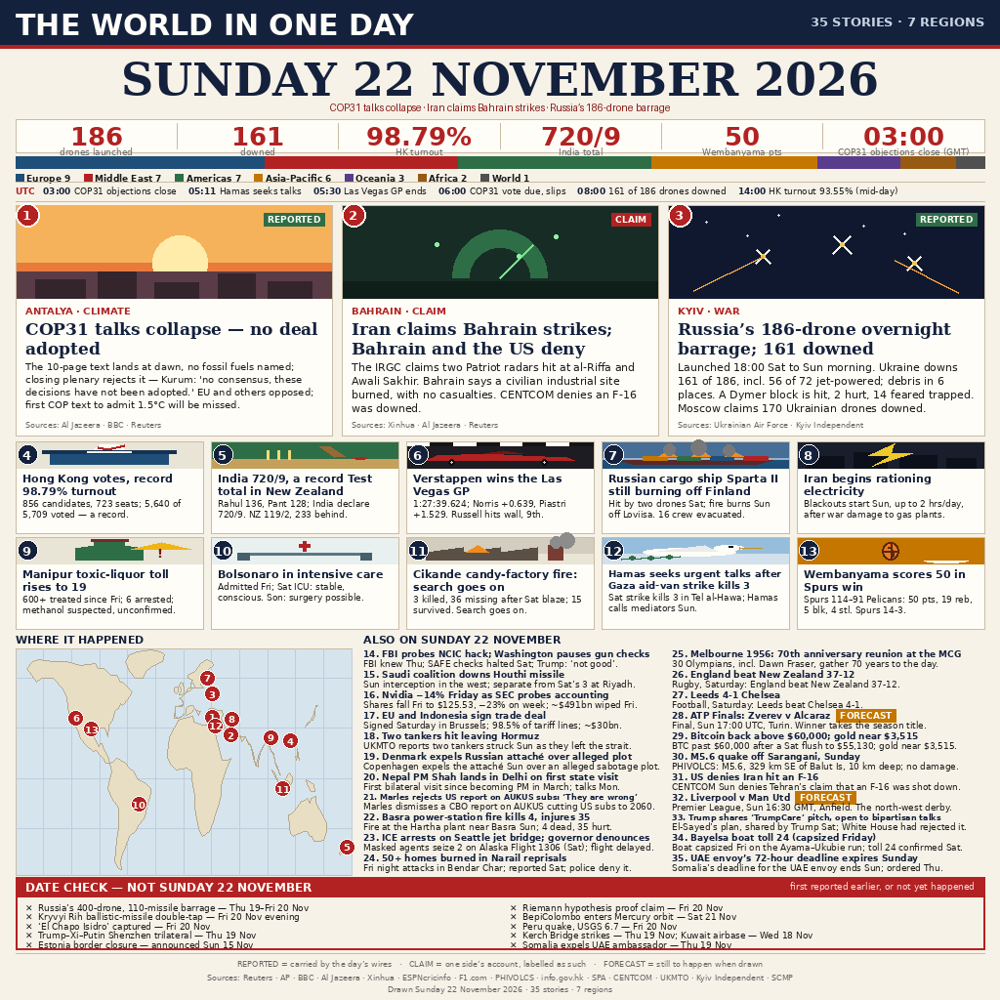

# The World in One Day — Sunday 22 November 2026

[](https://make.fun/bounty/news-image-20261122?utm_source=github&utm_medium=readme&utm_campaign=news-image-20261122)
[](https://make.fun/bounty/news-image-20261122/leaderboard?utm_source=github&utm_medium=readme&utm_campaign=news-image-20261122)
[](https://make.fun/bounty/news-image-20261122?utm_source=github&utm_medium=readme&utm_campaign=news-image-20261122)

A make.fun **news-image-20261122** entry: one program that draws a single
1024×1024 front page summing up Sunday 22 November 2026's world news.



## What is on the page

- **35 dated stories from 7 regions** — 13 pictorial leads (3 big + 10
  medium) + 22 briefs, every one first reported on Sunday 22 November 2026.
- **Top stories:** COP31 talks collapse, no deal adopted · Iran claims
  Bahrain strikes (Bahrain and the US deny) · Russia's 186-drone barrage,
  161 downed.
- **A DATE CHECK box** naming what is *not* Sunday's news (the 400-drone
  barrage was 19–20 Nov, the Bayelsa boat toll is 24 not 26, and more).
- **Certainty labels:** REPORTED = carried by the day's wires · CLAIM = one
  side's account, labelled as such · FORECAST = still to happen when drawn.

## Run it

```sh
python3 main.py          # writes /output/entry.png (or $ENTRY_OUTPUT)
python3 verify.py        # static checks: data, tags, determinism, size
```

No network. Two runs write byte-identical PNGs. The image is 1024×1024
and under 1 MiB.

## Sources

Reuters · AP · BBC · Al Jazeera · Xinhua · ESPNcricinfo · F1.com ·
PHIVOLCS · info.gov.hk · SPA · CENTCOM · UKMTO · Kyiv Independent · SCMP.
